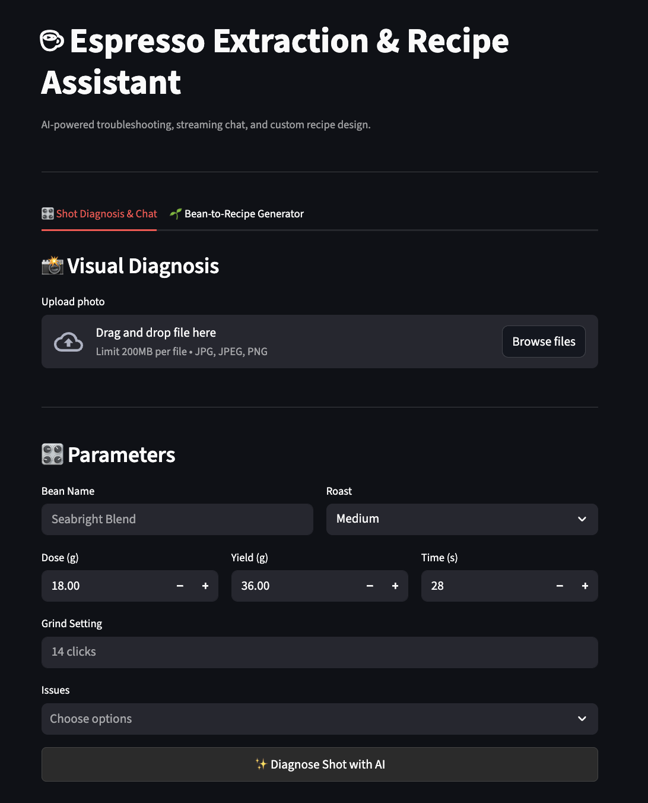

# Espresso Extraction & Recipe Assistant

A minimalist, AI-powered espresso troubleshooting and recipe design tool built with Streamlit and Google Gemini.

> **Preview**
> 

## Features

- **Shot Diagnosis**: Input extraction parameters (dose, yield, time, grind) and taste profiles to get direct, actionable barista feedback.
- **Visual Analysis**: Upload bottomless extraction shots or coffee puck photos for visual defect and channeling detection.
- **Interactive Coaching**: Multi-turn chat interface to ask follow-up questions and refine extraction adjustments iteratively.
- **Bean-to-Recipe Generator**: Generate tailored starting recipes based on coffee bean origin, roast level, and flavor notes.

## Tech Stack

- **Python**, **Streamlit**
- **Google GenAI SDK** (`google-genai`, Gemini 3.8 Flash)

## Getting Started

1. Clone the repository:
   ```bash
   git clone [https://github.com/noaheesu/espresso-ai-assistant.git](https://github.com/noaheesu/espresso-ai-assistant.git)
   cd espresso-ai-assistant
   ```
